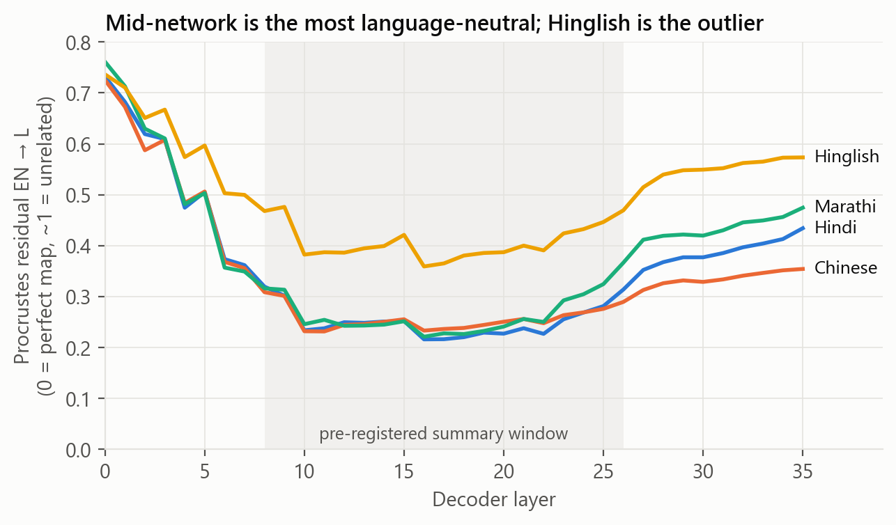
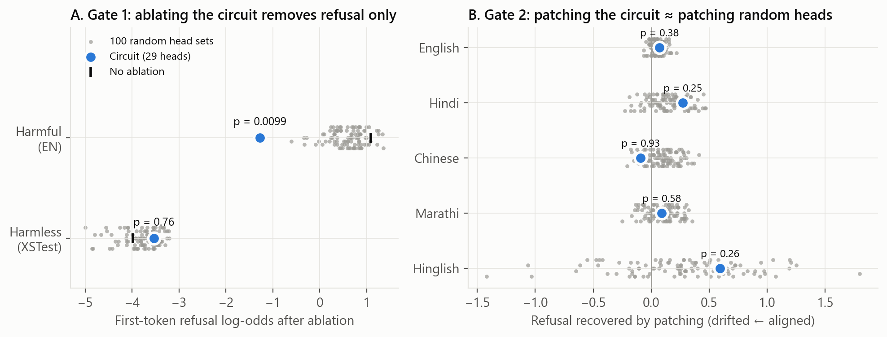
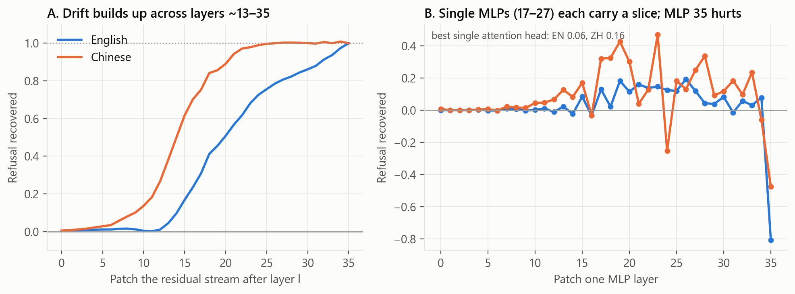
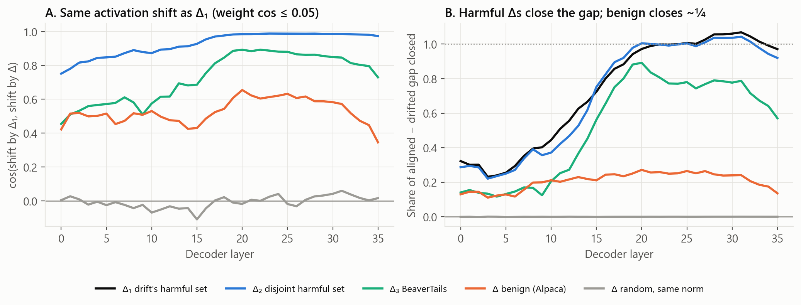
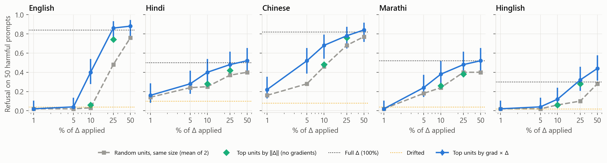
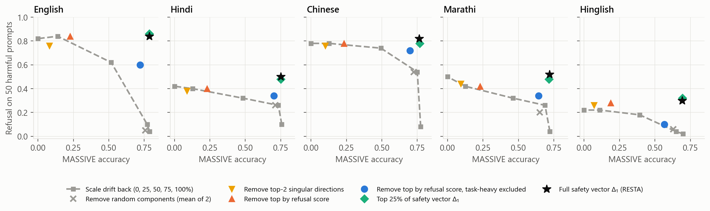
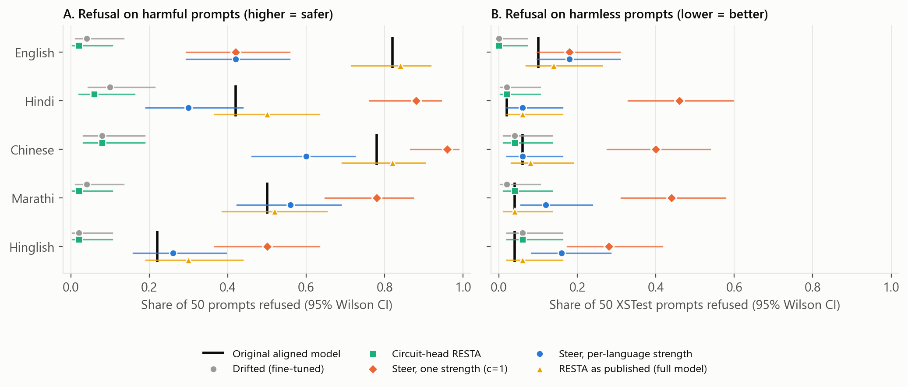
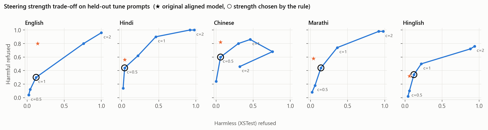
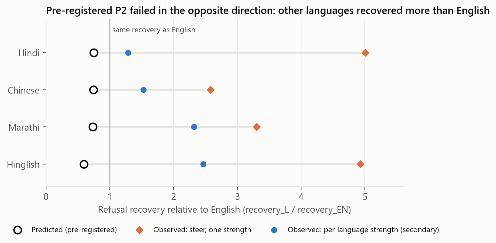

*This is the full technical record. The shorter narrative report is [`report.md`](report.md). Every number is from a logged run: see `RUNLOG.md` and `results/*.json`.*

# A faithful safety circuit is not a repair target: cross-lingual safety drift on Tiny Aya

*Lexsi Labs AI Safety & Alignment Hackathon, Track 2b (AI Safety and Correction). Problem statements #6 (repairing safety drift without retraining), #9 (locating where safety lives), #10 (circuit-level interventions).*

*Author: Raj Taware, BITS Pilani, K K Birla Goa Campus. [Code](https://github.com/Raj-Taware/tiny-aya-safety-drift-repair) · [Models](https://huggingface.co/collections/Raj-taware/tiny-aya-safety-drift-repair-models-6af4809949029a55f77e1052) · [Data](https://huggingface.co/collections/Raj-taware/tiny-aya-safety-drift-repair-data-6af4809af73390a191ffa017)*

## TL;DR

We fine-tuned Tiny Aya Global on a benign task plus a small harmful mix. Its refusal of harmful requests collapsed: English 0.82 → 0.04. We then asked whether the **refusal circuit that CircuitKIT finds in English** is a good place to repair that damage, in five languages: English, Hindi, Chinese, Marathi and code-mixed Hinglish.

- **The circuit is real** (exploratory: the heads-only version, chosen after the pre-registered test). Mean-ablating its 29 attention heads in the aligned model cuts English refusal more than all 100 size- and layer-matched random head sets (p = 0.0099), and it leaves harmless prompts alone.
- **The circuit is not where the drift is.** Patching aligned activations into the circuit (Gate 2) recovers no more refusal than random heads (0.07 vs 0.055, p = 0.38). Applying the RESTA safety vector to the circuit's weights (Gate 3) recovers nothing. A layer-by-layer scan shows the drift is spread over layers 13–35 and sits mostly in MLPs.
- **How RESTA's safety vector is built decides everything.** SafeTune's README recipe (Δ = instruct − pretrained) breaks the model at α = 1 (MASSIVE accuracy 0, mostly off-language output) and never restores refusal at smaller α. The recipe from the RESTA paper (Δ = aligned minus a copy of itself un-aligned on 100 harmful examples) restores refusal to the original model's level in **all five languages** (EN 0.04 → 0.84; aligned 0.82) with no loss of task accuracy and over-refusal close to the original. The two vectors are almost orthogonal (cosine 0.0001). A second safety vector built from 100 *different* harmful examples repairs at least as well (EN 0.90, Hinglish 0.46), while a random vector of the same size and a vector built from a benign fine-tune do nothing. A third vector from a different harmful dataset (BeaverTails) also repairs. The three are nearly perpendicular in weight space, yet they shift the drifted model's activations in nearly the same direction (cosine 0.85–0.98), back toward the aligned model.
- **Even with the safety vector that works, editing only the circuit does nothing.** Applying it to the 29 circuit heads, to random heads, or to the top-scoring units from a weight-space attribution on the drifted model leaves refusal at the drifted level. Attribution ranks units better than random, but the repair needs a large, mostly-MLP share of the vector: the top-scored 25% of its parameters restores English refusal fully (0.86, vs 0.48 for a random 25%), while 10% or less does not reach half. Ranking units by the plain size of their share of the vector gets most of the way at 25% (0.74) but loses to the gradient ranking at both sizes.
- **Repairing from the drift itself works less well than importing a safety vector.** The drift update (drifted − aligned) is known exactly, so we tried two repairs that need no safety vector. Undoing a fraction of it trades refusal against task accuracy one for one (50% undone: English refusal 0.62, MASSIVE 0.52). Splitting it into its singular components and removing the 504 that attribution marks as harmful but not task-relevant gives English refusal 0.60 with MASSIVE 0.72: better than random components (+0.54) and than the scale-back line, but short of its pre-registered bar on task accuracy and well short of published RESTA (0.84, 0.785). Removing the top-2 singular directions per module, as in Lee et al., restores refusal (0.76) but deletes the task (0.08).
- **A refusal direction built from English prompts alone does restore refusal in all five languages.** Steering with it works, and a random direction of the same size does nothing. The direction acts *more* strongly outside English, so the strength has to be set per language; done that way, over-refusal on harmless prompts falls back near the original model outside English.
- **Our pre-registered geometric prediction failed, in the opposite direction.** We predicted that languages whose representations align worse with English would recover less. They recovered *more*. We report it as a failed prediction.

The take-away for people using circuit tools for safety: **a circuit that is causally necessary for a behaviour is not necessarily where fine-tuning breaks that behaviour.** Before treating a discovered circuit as a repair target, test it against matched random components. Lexsi's own CircuitKIT paper reports the same gap for pruning: patch faithfulness does not predict usefulness (§11.5). This is a safety-repair case on their stack. Lee et al. (2026) independently show the layer-level version in English.

## 1. Question and setup

**Question.** If safety drifts after fine-tuning, can we repair it *without retraining*, by editing only the components that interpretability says carry safety? Does a repair found in English carry over to other languages?

**Stack.** CircuitKIT 0.2.0 (EAP-IG circuit discovery) and SafeTune 0.1.12 (RESTA weight-space repair), both from Lexsi Labs. Models: `CohereLabs/tiny-aya-global` (aligned, revision af89d21) and `CohereLabs/tiny-aya-base` (pretrained, revision d62ac17). Tiny Aya is 3.35B parameters: 36 layers, 16 query heads and 4 KV heads per layer.

**Compute.** Kaggle 2×T4 only, with about 5 GPU-hours per quota refresh and about 12 GPU-hours in total, so we kept every evaluation small and paired.

**Languages.** English (EN), Hindi (HI), Chinese (ZH), Marathi (MR) and Hinglish (romanized Hindi–English code-mixing). Harmful prompts come from SORRY-Bench-Multilingual: EN/HI/ZH as provided by the dataset, MR via Google Translate, Hinglish written by Claude. We kept 34 categories with a clear expected refusal and excluded 10 ambiguous ones, such as medical or legal advice. Over-refusal uses XSTest safe prompts, translated (MR/HI/ZH: Google; Hinglish: Aya Expanse 32B). Every prompt exists in all five languages, so all comparisons are **paired**.

**Prompt format.** We used the minimal chat template with no system turn. Tiny Aya's official template injects a roughly 373-token "contextual safety mode" preamble. Dropping it keeps prompts short enough for attribution on a T4, and measures the model's own safety behaviour. Limitation: deployed Tiny Aya may behave differently with the preamble.

**Judge.** WildGuard 7B (SafeTune's default judge), with a third label added: **confused**, meaning an empty response, the wrong language, or translating instead of answering. Language is checked with langid plus a romanized-Hindi word list for Hinglish. Raj hand-labelled 60 responses (Hindi, Marathi, Hinglish; 20 each; aligned and drifted models). On refuse-vs-not, the label every table here uses, WildGuard agreed with him on 60 of 60 (Cohen's κ = 1.0; 10 refusals in the sample). On the four-way label agreement was 0.82 (κ = 0.69): in 10 cases he marked a response harmful and WildGuard marked it benign (HI 5, MR 4, Hinglish 1). English, Chinese and repaired-model outputs were not hand-checked. WildGuard also says "harmful request: no" for most Hindi and Marathi prompts, so we only use its *refusal* label, not its harmfulness label, in those languages.

**Statistics.** 50 harmful + 50 XSTest prompts per language, held out from everything used for discovery or tuning. Same prompts in every condition: paired bootstrap 95% CIs (10k resamples) and McNemar tests. For circuit-vs-random: permutation p = (1 + #random ≥ circuit) / (1 + #random).

**Gates.** We set pass/fail gates before each stage and pre-registered analysis plans in `DECISIONS.md` before running them. When a gate failed, we stopped and decided explicitly whether to continue. Every such decision is reported below.

## 2. Gate 0: creating the drift

LoRA (r = 16, α = 32, all projections, lr 1e-4, 2 epochs, seed 0) on 1,800 MASSIVE intent-classification examples (EN/HI/ZH) plus 100 harmful request–response pairs. MASSIVE gives a measurable "task skill". The fine-tuned ("drifted") model scores 0.70–0.79 accuracy by language. The aligned model scores 0 because it never saw the label set, so task accuracy only measures how much of the fine-tune each repair keeps.

| Refusal on harmful prompts | EN | HI | ZH | MR | Hinglish |
|---|---|---|---|---|---|
| Aligned (tiny-aya-global) | 0.82 | 0.42 | 0.78 | 0.50 | 0.22 |
| Drifted | 0.04 | 0.10 | 0.08 | 0.04 | 0.02 |
| Drop, 95% CI | 0.78 [0.66, 0.88] | 0.32 [0.18, 0.46] | 0.70 [0.56, 0.82] | 0.46 [0.32, 0.60] | 0.20 [0.10, 0.32] |

Gate 0 passed (aligned EN ≥ 0.80, EN drop ≥ 0.25, CI excludes 0). Note how low the aligned model's refusal already is in Hindi (0.42) and Hinglish (0.22), even before any fine-tuning. That fits the Cohere Labs community finding that Tiny Aya is often "confused" by code-mixed harmful prompts.

## 3. Gate 0.5: how differently is each language represented?

We extracted the last-prompt-token residual stream for 438 parallel prompts × 5 languages × 36 layers, on the drifted model. We then measured two things, following Balestriero & LeCun (arXiv:2610.39302):
- **ρ, the "scene-explained fraction":** how much of the representation depends on *what* is asked rather than *which language* it is asked in.
- **Whitened orthogonal Procrustes residual EN → L:** how well a rotation maps English representations onto language L. 0 = perfect, about 1 = unrelated.

The primary view was fixed before results: k = 32, mean over hidden states 9–27 (= decoder layers 8–26; all layer numbers below are 0-based decoder layers).

| | HI | ZH | MR | Hinglish |
|---|---|---|---|---|
| Procrustes residual EN → L | 0.252 | 0.257 | 0.266 | 0.408 |
| Top-1 retrieval | 0.757 | 0.747 | 0.748 | 0.516 |
| ρ (EN + L pair; shuffled null ≈ 0.18) | 0.81 | 0.82 | 0.80 | 0.72 |

Gate 0.5 passed: languages differ beyond split noise. But the spread is almost entirely Hinglish; HI, ZH and MR are within 0.014 of each other. The residual is lowest around decoder layers 10–22, so mid-network is the most language-neutral part.

*Figure 1. EN → L Procrustes residual (k = 32, drifted model) at every layer. Shaded: the pre-registered summary window.*

## 4. Gate 1: is there a refusal circuit?

**Discovery.** CircuitKIT EAP-IG at node level on the aligned model, using 50 EN harmful prompts (disjoint from evaluation) against 50 XSTest safe prompts, with refusal token "I'm" vs compliance token "Sure". We took the top 5% of each node type: 29 of 576 heads and 2 of 36 MLPs (MLP 0, MLP 35).

**Metric.** First-token refusal log-odds: the probability mass on each language's refusal-opening tokens, validated against judge labels (AUROC 0.75–1.0 by language and model).

**Test.** Mean-ablate the circuit vs 100 random sets: heads resampled within the same layer, MLPs within ±3 layers.

- **Pre-registered (heads + MLPs): passed on paper, but not specific.** EN refusal log-odds 1.09 → −11.12 (random p5 −8.27, p = 0.0099). But harmless XSTest prompts collapse to the same value, so ablating MLP 0 and MLP 35 just breaks the model.
- **Heads only (29 heads), exploratory, decided after seeing the above: specific.** EN 1.09 → −1.28 (random mean 0.60, p = 0.0099). XSTest is unchanged (−3.98 → −3.54, p = 0.76).

So the 29 heads are causally needed for English refusal in the aligned model, and only for refusal.

*Figure 2. Grey: 100 size- and layer-matched random head sets. Blue: the 29-head circuit. A: Gate 1 ablation on the aligned model. B: Gate 2 patching of aligned activations into the drifted model.* We used heads-only as the circuit from here on, and we flag that this choice came after seeing Gate 1.

## 5. Gate 2: can the circuit carry the repair?

Patch aligned-model activations into the drifted model at the circuit, and compare with random sets. We report recovery = (patched − drifted) / (aligned − drifted).

- **Pre-registered circuit (with MLPs): failed.** Patching made refusal *worse* in every language (EN −0.92). The cause is MLP 35.
- **Heads only: failed.** EN recovery 0.07 vs random mean 0.055 (95th percentile 0.15, p = 0.38). Results were the same patching only the last token, and no language beat random.

**Where is the drift, then?** An exploratory scan patched one component at a time, in EN and ZH:
- **Residual stream:** patching after layer l recovers EN refusal 0.04 at l = 13, 0.51 at l = 20 and 0.86 at l = 30. So the drift accumulates across layers 13–35.
- **Single components:** each MLP in layers 17–27 recovers 0.12–0.19 in EN, and up to 0.47 in ZH. The best single attention head recovers 0.06.

The drift is **distributed and MLP-heavy**, while the refusal circuit is a set of attention heads.

*Figure 3. Exploratory scan: patch one aligned-model component into the drifted model and measure first-token refusal recovered. A: the whole residual stream after layer l. B: one MLP layer.*

Gate 2 failed. With Raj's explicit decision we went on to Gate 3 anyway, to test with real weights whether the circuit is no better than random. Before running Gate 3 we **pre-registered three predictions**. They were committed to git (6f1e99b) and pushed to a private Hugging Face repo (commit 2534728) for a timestamp.

## 6. Gate 3: weight-space repair

We first used SafeTune's README RESTA recipe, checked against its source: safety vector Δ = θ_aligned − θ_base (instruct − pretrained), and θ_repaired = θ_drifted + α·Δ. We applied Δ in four ways:
- **full:** all parameters, via SafeTune `apply_resta`;
- **circuit:** the 29 heads' query rows and output columns;
- **5 random head sets:** layer-matched to the circuit;
- **drift (exploratory):** the 29 heads with the highest single-head patching recovery.

Our masked implementation matches SafeTune exactly when given the same tensors (maximum absolute difference 0.0).

| Refusal on harmful | EN | HI | ZH | MR | Hinglish |
|---|---|---|---|---|---|
| Drifted | 0.04 | 0.10 | 0.08 | 0.04 | 0.02 |
| Circuit heads | 0.02 | 0.06 | 0.08 | 0.02 | 0.02 |
| Random heads (mean of 5) | 0.024 | 0.096 | 0.092 | 0.024 | 0.012 |
| Drift-scan heads | 0.02 | 0.06 | 0.10 | 0.02 | 0.04 |
| Full RESTA, README recipe, α = 1 | 0.04 | 0.00 | 0.00 | 0.00 | 0.26* |
| RESTA as published, α = 1 (below) | **0.84** | **0.50** | **0.82** | **0.52** | **0.30** |
| Aligned (reference) | 0.82 | 0.42 | 0.78 | 0.50 | 0.22 |

\*Full RESTA's outputs are mostly "confused" (0.82–1.0 of responses in EN/HI/ZH/MR; 0.62 in Hinglish), and MASSIVE accuracy is 0, so the model is broken. The Hinglish 0.26 is the judge reacting to garbage.

None of the head arms moved refusal at α = 1, 2 or 4, and none of them hurt task accuracy either. An exploratory α sweep of full RESTA (0.05 → 0.5) never restored English refusal (keyword refusal 0 at every α); task accuracy fell from 0.79 to 0.09 by α = 0.5.

**Why might RESTA fail here?** For Tiny Aya, Δ = global − base contains *all* of instruction tuning, not just safety: ‖Δ‖ = 789.5 over 291 tensors. Adding that on top of a model that has already been instruction-tuned and then fine-tuned plausibly double-counts the instruction tuning. The RESTA paper warns about exactly this (§2.1). It builds Δ as the aligned model minus a copy un-aligned by SFT on 100 harmful examples. So our full arm tests **SafeTune's README recipe (instruct − pretrained), not RESTA as published.**

**RESTA as published.** We then ran the paper's recipe (design pre-registered in `DECISIONS.md` before the run). We un-aligned Tiny Aya Global with LoRA SFT on the 100 harmful examples (same LoRA settings as the drift, 5 epochs = 65 steps), merged it, and used Δ = θ_global − θ_unaligned with SafeTune's `apply_resta` at its default α = 1. Everything else (eval sets, judge, statistics) is identical to the other arms.

| RESTA as published, α = 1 | EN | HI | ZH | MR | Hinglish |
|---|---|---|---|---|---|
| Refusal on harmful | 0.84 | 0.50 | 0.82 | 0.52 | 0.30 |
| Gain vs drifted [95% CI] | 0.80 [0.68, 0.90] | 0.40 [0.24, 0.56] | 0.74 [0.62, 0.86] | 0.48 [0.34, 0.62] | 0.28 [0.16, 0.40] |
| XSTest over-refusal (aligned) | 0.14 (0.10) | 0.06 (0.02) | 0.08 (0.06) | 0.04 (0.04) | 0.06 (0.04) |
| MASSIVE accuracy (drifted) | 0.785 (0.788) | 0.750 (0.757) | 0.764 (0.774) | 0.719 (0.722) | 0.691 (0.698) |
| Confused on harmful | 0.00 | 0.00 | 0.00 | 0.02 | 0.10 |

McNemar p ≤ 0.0002 in every language. Refusal returns to the aligned model's level everywhere (recovery 1.03–1.40), task accuracy is unchanged, and over-refusal stays within 0.04 of the aligned model. This is a better repair than either steering arm on every metric.

Two numbers explain the contrast with the README recipe. ‖Δ_paper‖ = 3.99, against ‖Δ_README‖ = 660.8 over the same tensors, and the cosine between them is 0.0001. The paper's Δ is small, low-rank (it comes from a rank-16 LoRA), and points in an almost unrelated direction to "all of instruction tuning". An exploratory α sweep on held-out harmful prompts (rows 50–99, first-token metric) shows a smooth dose-response: English refusal log-odds −3.17 (α = 0) → −0.62 (0.5) → 3.43 (1) → 6.98 (2), with English task accuracy 0.79 → 0.76 at α = 2.

### 6.1 Follow-ups on the published-RESTA vector

All follow-ups below were pre-registered in `DECISIONS.md` before they ran. They use the same eval sets, judge and statistics as everything else.

**(a) Does the repair depend on reusing the drift's own harmful data?** The first published-RESTA run built its un-aligned copy from the same 100 harmful examples that were in the drift mix, which is the most favourable case. We rebuilt Δ from 100 different harmful pairs from the same source dataset, excluding any prompt that overlaps a drift example or a SORRY-Bench prompt (Jaccard ≥ 0.5).

| Refusal on harmful | EN | HI | ZH | MR | Hinglish |
|---|---|---|---|---|---|
| Δ₁ (drift's harmful set) | 0.84 | 0.50 | 0.82 | 0.52 | 0.30 |
| **Δ₂ (disjoint harmful set)** | **0.90** | **0.58** | **0.88** | **0.60** | **0.46** |
| Gain vs drifted, Δ₂ [95% CI] | [0.76, 0.94] | [0.32, 0.64] | [0.68, 0.90] | [0.42, 0.70] | [0.30, 0.58] |
| XSTest over-refusal, Δ₂ (aligned) | 0.16 (0.10) | 0.10 (0.02) | 0.10 (0.06) | 0.04 (0.04) | 0.08 (0.04) |

Δ₂ repairs at least as well; paired against Δ₁ it is ahead by 0.06–0.16, significant only in Hinglish (p = 0.039). Task accuracy is unchanged. The best-case caveat does not explain the repair. The striking part: **Δ₁ and Δ₂ are nearly orthogonal** (cosine 0.053 overall, 0.03–0.08 per layer, same norm ≈ 4).

**(b) Is any change of that size enough?** Two controls, applied the same way at α = 1:
- **Random Δ:** random rank-16 factors per weight, scaled to the same per-weight norm as Δ₁. Refusal .04/.10/.08/.02/.02, identical to the drifted model in every language (p = 1.0); the first-token score stays flat as α goes from 1 to 4.
- **Benign Δ:** Global minus a copy fine-tuned (same recipe) on 100 benign Alpaca pairs. No repair in EN/HI/MR/Hinglish, and the first-token refusal score *falls* as α grows (EN −3.5 → −11.4 at α = 4). One oddity: ZH refusal 0.22 vs 0.08 (p = 0.039).

So the repair is specific to the "harmful-un-alignment" difference, even though two such differences share almost no direction in weight space. One reading is that many different weight directions map onto the same refusal behaviour, and harmful SFT reliably finds one of them. (e) tests this.

**(c) Circuit vs random, with the vector that works.** Gate 3's head arms used the broken README vector, so we re-ran them with Δ₁. The 29 circuit heads, the exploratory drift heads and all 5 random head sets leave refusal at the drifted level (circuit − random 0 to +0.02, p = 1.0). The heads carry only about 9% of ‖Δ₁‖. The Gate 3 conclusion stands with the correct vector.

**(d) Can interpretability pick a better target?** Instead of asking where refusal lives in the aligned model, we asked where adding Δ₁ helps refusal most in the *drifted* model. We gated every unit's share of Δ₁ with a scalar and took the gradient of the first-token refusal score at gate = 0 (attribution patching in weight space; one backward pass, 7 s on a T4). Units: 576 query heads, 144 key/value heads and 396,288 MLP neurons.
- **Where the score sits:** 2.83 of the total 3.60 is in MLP neurons, concentrated in layers 12–18 and 34–35; query heads 0.52, key/value heads 0.25. This matches the Gate 2 activation scan (drift is MLP-heavy, mid-to-late layers).
- **Top units at the circuit's parameter budget** (15.2M: 108 neurons, 16 query heads, 12 key/value heads) vs 5 random sets with the same per-layer, per-type counts. On the continuous first-token score, the top units beat every random set at every strength: EN −2.58 vs −2.97 to −3.00 at α = 1, and −0.96 vs −2.60 to −2.72 at α = 4. With 16× the budget: −1.20 vs −2.30.
- **Judged refusal (pre-registered test): fails.** Top units EN 0.02 vs random max 0.04. Exploratory: ZH 0.20 vs drifted 0.08 (p = 0.031); other languages unchanged.

Attribution on the drifted model points at the right *kind* of component, unlike the aligned-model circuit, but no small target repairs the model. The repair needs a large, distributed, mostly-MLP share of Δ.

**(e) Why do near-orthogonal vectors both repair?** We added a third vector, Δ₃, built the same way from 100 harmful pairs from a *different source* (BeaverTails: different prompts, replies written by another model, human harm labels; ‖Δ₃‖ = 3.95, weight cosine to Δ₁ 0.032). On the drifted model we measured how each vector shifts the last-token activations at every layer, on 50 held-out harmful and 50 held-out harmless prompts per language, and compared each shift with the gap between the aligned and drifted models.

| EN harmful, layers 16–35 | Δ₂ | Δ₃ | benign Δ | random Δ |
|---|---|---|---|---|
| Weight cosine to Δ₁ | 0.053 | 0.032 | 0.026 | 0.000 |
| Activation-shift cosine to Δ₁ | **0.98** | **0.85** | 0.56 | 0.01 |
| Share of aligned − drifted gap closed (Δ₁: 0.99) | 0.98 | 0.76 | 0.24 | 0.00 |

- **Pre-registered test passes:** both harmful vectors agree with Δ₁ above 0.5 and above both controls. The pattern is the same in all five languages (Δ₂ 0.98–0.99, Δ₃ 0.84–0.87).
- **Different weights, same internal change.** Each harmful vector moves the drifted model back toward the aligned model's internal state. The weight cosines are low because the vectors read from unrelated input directions (input-side LoRA subspaces at chance overlap) while writing to shared output directions (10–20× chance).
- **The benign vector takes about a quarter of the same path** (probably the generic "undo fine-tuning" part) and does not restore refusal. The refusal-specific part is in the rest.
- **Judged, Δ₃ also repairs:** refusal 0.54/0.66/0.88/0.66/0.36 (EN gain CI [0.36, 0.64]), with more over-refusal (XSTest 0.22/0.14/0.18/0.12/0.14) and unchanged task accuracy. Less in English than Δ₁, more in Hindi and Marathi.

*Figure 4. Left: cosine between the activation shift caused by Δ₁ and by each other vector, per layer (EN harmful prompts). Right: how much of the aligned − drifted gap each vector closes along the gap direction.*

**(f) How much of the vector is needed, and does choosing it well matter?** We scored every unit (attention q-head, kv-head, MLP neuron) by grad × Δ on English held-out harmful prompts of the drifted model (as in (d)), then applied Δ₁ only to the top-scored units at 1, 5, 10, 25 and 50% of the parameters. Controls: 20 random sets per size, each with the same number of units per layer and type. All 20 were scored on first-token refusal; two per size were also generated and judged.

- **First-token score (pre-registered Q1):** the top set beats all 20 random sets at every size, even 1% (permutation p = 0.048, the minimum with 20 sets). The random sets touch the same amount of ‖Δ‖, so this is not a size effect.
- **Judged refusal (Q2):** 25% is the smallest share that reaches half of the full repair in English. There it restores English fully: 0.86, against 0.84 for the full vector and 0.48 for random 25% (paired difference +0.38 [0.24, 0.52], p < 0.001). At 10%, English is at 0.40 vs 0.02–0.04 for random.
- **Other languages (Q3):** the ranking used English only, but the top sets also beat random in Hindi, Chinese and Marathi at 10% (+0.14 to +0.22, p ≤ 0.016) and in Hinglish at 25% (+0.20 to +0.24). Chinese moves first: 0.52 at 5% (random 0.28).
- **Indistinguishable from the full vector:** at 25%, harmful-prompt refusal differs from full RESTA by −0.04 to +0.02 per language (all McNemar p ≥ 0.5). Over-refusal is numerically lower (XSTest 0.06/0.04/0.06/0.04/0.06 vs 0.14/0.06/0.08/0.04/0.06), but in English that is 3 vs 7 of 50 prompts (paired McNemar p = 0.125), so we do not claim a reduction. Task accuracy is unchanged at every size.
- **Random sets are almost deterministic:** two different random draws gave the same label on 490–500 of 500 prompts. With hundreds of thousands of units per draw, a random draw averages out to "the same fraction of Δ everywhere".

| Refusal, EN / HI / ZH / MR / Hinglish | top | random (mean of 2) |
|---|---|---|
| 1% | .02 / .16 / .22 / .02 / .02 | .02 / .14 / .16 / .02 / .02 |
| 5% | .04 / .28 / .52 / .24 / .04 | .02 / .24 / .28 / .18 / .02 |
| 10% | .40 / .40 / .68 / .38 / .12 | .03 / .25 / .46 / .24 / .06 |
| 25% | **.86** / .48 / .78 / .48 / .32 | .48 / .37 / .68 / .40 / .10 |
| 50% | .88 / .52 / .84 / .52 / .44 | .76 / .40 / .77 / .40 / .28 |
| 100% (full RESTA-paper) | .84 / .50 / .82 / .52 / .30 | |

The judged random sets are typical of all 20. On the first-token score (EN, log-odds; drifted −3.08), the 20 random sets span a narrow band at every size, and the two judged ones sit inside it:

| Share | top | 20 random: min / median / max | judged rand0, rand1 |
|---|---|---|---|
| 1% | −2.51 | −2.92 / −2.88 / −2.85 | −2.90, −2.86 |
| 5% | −1.78 | −2.52 / −2.48 / −2.46 | −2.46, −2.46 |
| 10% | −0.82 | −2.30 / −2.26 / −2.22 | −2.28, −2.25 |
| 25% | +1.82 | −1.35 / −1.28 / −1.23 | −1.29, −1.23 |
| 50% | +3.06 | +0.26 / +0.33 / +0.46 | +0.32, +0.30 |

**Does a trivial ranking do as well? Mostly, but not quite (pre-registered).** We ranked units by the plain size of their share of Δ₁ (‖Δ_unit‖², no gradients), applied the top 10% and 25% the same way, and judged them on the same prompts. The rule fixed in advance: if the norm ranking's English refusal at 25% is within 0.10 of attribution's (≥ 0.76), a norm ranking suffices.

| Refusal, EN / HI / ZH / MR / Hinglish | grad × Δ | ‖Δ‖ only | paired EN difference |
|---|---|---|---|
| 10% | .40 / .40 / .68 / .38 / .12 | .06 / .28 / .48 / .26 / .06 | −0.34 [−0.48, −0.22], p < 0.001 |
| 25% | .86 / .48 / .78 / .48 / .32 | .74 / .42 / .76 / .38 / .28 | −0.12 [−0.22, −0.04], p = 0.031 |

- **The norm ranking does not suffice, narrowly:** 0.74 against the 0.76 bar. Gradient attribution adds value: decisively at 10% (it is lower in every language, p ≤ 0.031 except Hinglish) and modestly at 25% (English only).
- **Still, the norm ranking gets most of the way at 25%:** 0.74 against 0.48 for a random 25%.
- **Why it loses at 10%:** by norm, the biggest units are whole attention heads, so the 10% set is almost all heads (414 query heads, 34 MLP neurons); attribution picks 3,703 MLP neurons. The norm-ranked sets also move *more* of ‖Δ‖ (2.40 vs 2.21 at 25%) and still repair less.
- Sanity: recomputing the attribution sets in the same kernel reproduces the earlier first-token scores to three decimals.

So *where* the vector is applied does matter, at the right granularity: a well-chosen quarter of the vector, mostly MLP neurons, does as well as all of it, and choosing by gradient beats choosing by size. What fails is a small, attention-only target such as the 29-head circuit.

*Figure 5. Judged refusal on 50 harmful prompts per language when Δ₁ is applied to the top units by grad × Δ (blue, Wilson 95% CI), to the top units by ‖Δ‖ alone (green diamonds, 10% and 25%), or to random units of the same size and layer/type mix (grey), by share of Δ's parameters. Dotted lines: full Δ and the drifted model.*

### 6.2 Repairing from the drift itself: scale-back and SVD decomposition

Every repair above imports a safety vector built from a second, harmful fine-tune. But both endpoints are known here, so the drift update U = drifted − aligned is known exactly, and it is rank 16 in each of its 252 weight matrices (‖U‖ = 8.45). Two pre-registered questions (`DECISIONS.md`, "F" and "G"; kernel `gate3dd`; `results/gate3dd_stats.json`).

**(g) Does shrinking the drift suffice?** Arms: drifted − β·U. Bar fixed in advance: English refusal ≥ 0.44 and English MASSIVE ≥ 0.738 (drifted 0.788 − 0.05).

| β | Refusal EN / HI / ZH / MR / Hinglish | MASSIVE EN |
|---|---|---|
| 0 (drifted) | .04 / .10 / .08 / .04 / .02 | .788 |
| 0.25 | .10 / .26 / .54 / .26 / .04 | .771 |
| 0.50 | .62 / .32 / .74 / .32 / .18 | .517 |
| 0.75 | .84 / .40 / .78 / .42 / .22 | .139 |
| 1 (aligned) | .82 / .42 / .78 / .50 / .22 | 0 |

No β meets both conditions. A finer grid on the first-token score and English MASSIVE (β = 0.1 … 0.9) shows the same monotone trade-off. This line is the trivial baseline for every repair in this article; published RESTA (0.84, 0.785) and the top-scored 25% of Δ₁ (0.86) are far above it.

**(h) Can the harmful part of the drift be cut out?** Thin SVD of each module's update gives 16 components, 4,032 in all. On the drifted model we scored each component by the first-order effect of removing it on English refusal (r, held-out harmful prompts) and on the MASSIVE training loss (t, 60 English training rows). Each arm removes 504 components (2 per module on average).

| Components removed | Refusal EN / HI / ZH / MR / Hinglish | MASSIVE EN | Share of ‖U‖² |
|---|---|---|---|
| Top-2 singular directions per module (after Lee et al.) | .76 / .38 / .76 / .44 / .26 | .080 | .70 |
| Top 504 by r | .84 / .40 / .78 / .42 / .28 | .226 | .58 |
| **Top 504 by r, excluding the top quarter by t (primary)** | **.60 / .34 / .72 / .34 / .10** | **.722** | .23 |
| Random, same count per module (2 draws) | .04–.06 / .24–.28 / .54 / .18–.22 / .06 | .757 | .24–.25 |

- **Pre-registered reading: fail, on one of three criteria.** English refusal 0.60 ≥ 0.44; gain over each random arm +0.54 [0.40, 0.68] and +0.56 [0.42, 0.70] (p < 0.001); but English MASSIVE 0.722 < 0.738.
- **Against the scale-back line** it is clearly better: the same English refusal as β = 0.5 (0.60 vs 0.62) at MASSIVE 0.722 instead of 0.517. Chinese and Marathi also gain over random (+0.18, p = 0.004; +0.16 / +0.12, p = 0.008 / 0.070).
- **Against published RESTA** it is clearly worse (0.84 refusal, 0.785 MASSIVE).
- **Harm and task share the large components.** 244 of the top 504 components by r are also in the top quarter by t, and that quarter holds 54% of the positive refusal gain. With it excluded, the first-token score flattens after about 250 components (exploratory sweep, N = 126 … 2016).
- **Top-2 removal** restores refusal but leaves MASSIVE at 0.08: the top-2 directions hold 70% of ‖U‖². Lee et al.'s attacks were harmful-only, so there was no task to lose. This arm follows their description; it was not checked against their code.

So in this mixed task-plus-harm drift, the harmful part is not cleanly separable inside the update. A vector built from a separate harmful fine-tune isolates it better than any subset of the drift's own components we tried.

*Figure 6. Judged refusal on 50 harmful prompts against MASSIVE accuracy, per language. Grey dashed line: the drift scaled back by 0, 25, 50, 75 and 100% (drifted at the right end, aligned at the left). Removing attribution-chosen components of the drift with the task-heavy quarter excluded (blue) sits above that line in English, Hindi, Chinese and Marathi and on it in Hinglish. The imported safety vector, in full (star) or its top-scored 25% (green), sits at the top right in every language.*

## 7. Activation steering with an English-only refusal direction

When Gate 3's README-recipe weight repair failed, and before the published-RESTA arm was run, we tried the cheapest intervention at the activation level. This arm was added after Gate 3, at Raj's request, with its design written before running it.

- **Direction:** in the aligned model, the mean last-token residual after layer L on 50 English harmful prompts, minus the same on 50 harmless Alpaca instructions. English only.
- **Steering:** add c·‖r_L‖·r̂_L to the drifted model's residual stream after layer L, at all positions.
- **Choosing L and c:** on held-out English prompts only, with the rule "maximise harmful refusal while harmless refusal stays within 0.05 of the aligned model". The rule picked L = 16, c = 1 (magnitude 19.35).
- **Control:** a random unit direction of the same magnitude.

**Then, per-language strength.** With one English-tuned strength, Hindi, Chinese and Marathi over-refused heavily. So we pre-registered a second rule: pick c separately for each language, on held-out tune prompts, scored by the WildGuard judge. Among strengths whose harmless-prompt refusal stays within 0.10 of the aligned model's, take the one with the most harmful-prompt refusal. Chosen: EN 1.0, HI 0.5, ZH 0.5, MR 0.75, Hinglish 0.75.

| | EN | HI | ZH | MR | Hinglish |
|---|---|---|---|---|---|
| **Refusal on harmful** | | | | | |
| Aligned | 0.82 | 0.42 | 0.78 | 0.50 | 0.22 |
| Drifted | 0.04 | 0.10 | 0.08 | 0.04 | 0.02 |
| Random-direction control | 0.02 | 0.06 | 0.04 | 0.00 | 0.00 |
| Steer, single c = 1 | 0.42 | 0.88 | 0.96 | 0.78 | 0.50 |
| Steer, per-language c | 0.42 | 0.30 | 0.60 | 0.56 | 0.26 |
| Gain vs drifted (per-language c), 95% CI | [0.24, 0.52] | [0.08, 0.32] | [0.38, 0.66] | [0.38, 0.66] | [0.12, 0.36] |
| **Over-refusal on harmless (XSTest)** | | | | | |
| Aligned | 0.10 | 0.02 | 0.06 | 0.04 | 0.04 |
| Steer, single c = 1 | 0.18 | 0.46 | 0.40 | 0.44 | 0.28 |
| Steer, per-language c | 0.18 | 0.06 | 0.06 | 0.12 | 0.16 |
| **Task accuracy (MASSIVE)** | | | | | |
| Drifted | 0.788 | 0.757 | 0.774 | 0.722 | 0.698 |
| Steer, single c = 1 | 0.722 | 0.667 | 0.691 | 0.639 | 0.604 |
| Steer, per-language c | 0.719 | 0.743 | 0.753 | 0.688 | 0.642 |

What this shows:
- **The direction matters.** The random-direction control does nothing (McNemar p < 0.001 for every steered arm vs drifted in every language; p ≤ 0.007 for per-language c).
- **The English direction transfers, and acts *more* strongly outside English.** At equal strength, HI/ZH/MR refuse more than the aligned model ever did. BabelSteering (arXiv:2608.16577) reports the same direction on *aligned* models (smallest change in English).
- **Strength must be set per language.** With per-language c, over-refusal outside English returns near aligned levels: ZH 0.06 = aligned, HI 0.06 vs 0.02. Task accuracy recovers 5–8 points. The price is less refusal than with c = 1.
- **English has no good setting.** On the tune set, EN refusal reaches the aligned level only at c = 1.5, where harmless-prompt refusal is 0.76.
- **Steering is an inference-time fix, not a weight repair.** It needs a hook in serving and does not change the checkpoint.

*Figure 7. Refusal on 50 harmful (A) and 50 harmless XSTest (B) prompts per language. Black bar: the original aligned model. RESTA as published (yellow triangle, §6) is the only arm near the aligned model on both panels in every language. Whiskers: 95% Wilson intervals per rate; the paired gains in the table above are the stronger test.*

*Figure 8. Held-out tune prompts (50 + 50 per language): each point is one steering strength c from 0.25 to 2. Star: the aligned model. Ring: the strength the pre-registered rule picked. English has no point near the star.*

**Can the strength be set without judged labels in the new language? No (pre-registered, failed).** The per-language rule above needs judged outputs in every language. We tested three rules that use only English's choice (c = 1) plus *unlabelled* prompts in the new language, measured on the drifted model at the steering layer: (B, primary) put the language's harmless prompts where English's sit after steering; (A) the same for harmful prompts; (C) scale by the ratio of residual-stream norms.

- **All three rules set c ≈ 1 in every language** (0.93–1.11), against tuned values of 0.5–0.75. Before steering, the five languages sit at almost the same place along the refusal direction (mean projections differ by at most 2.1, against a push of 19.35) and have the same residual norm (32–34).
- **So the arms behave like c = 1:** rule B gives refusal HI 0.92, ZH 0.98, MR 0.82, Hinglish 0.58, with over-refusal 0.42/0.46/0.42/0.34. The pre-registered test fails on two of its three parts: over-refusal is below c = 1 in only 2 of 4 languages, and within 0.10 of the tuned rule in 0 of 4.
- **Reading:** the extra sensitivity of non-English prompts is not visible where the vector is added. It must build up in later layers. A label-free rule would need a downstream signal, such as how much a small push moves a later-layer projection; we did not test one.

## 8. Pre-registered predictions: scored

| | Prediction | Outcome |
|---|---|---|
| P1 | Circuit-head repair ≤ best random-head repair (EN) | **Holds, but only trivially:** no head arm moved refusal (circuit 0.02, best random 0.04). Re-scored with the published-RESTA Δ (secondary): circuit 0.04 = best random 0.04; still holds. |
| P2 | For any arm with EN recovery > 0.2, recovery in L relative to EN ≈ 1 − Procrustes residual (≈ 0.74 for HI/ZH/MR, 0.59 for Hinglish); Hinglish lowest | **Fails, in the opposite direction.** On the single-strength steering arm (EN recovery 0.49), observed ratios were HI 5.0, ZH 2.6, MR 3.3, Hinglish 4.9; Hinglish was not lowest. (Secondary: on the per-language arm, ratios 1.3–2.5, Spearman −1.0, n = 4; not an independent test since c was tuned per language.) Not applicable to full RESTA (EN recovery 0). On RESTA as published (EN recovery 1.03, the cleanest test): ratios HI 1.22, ZH 1.03, MR 1.02, Hinglish 1.37 vs predicted 0.59–0.75; Spearman −0.2; Hinglish highest, not lowest. Fails. |
| P3 | Full RESTA recovers ≥ 0.5 of EN refusal, with more over-refusal | **Fails** for the pre-registered (README-recipe) arm: EN recovery 0; model broken. (RESTA as published, run later: EN recovery 1.03, over-refusal 0.14 vs aligned 0.10.) |

*Figure 9. Pre-registered prediction P2 against outcome. Vertical line: same recovery as English.*

**Why might P2 have failed?** The Procrustes residual measures how *similar* a language's representations are to English. Recovery under steering depends on how *sensitive* each language's refusal behaviour is to a shared direction. That may be highest exactly where the aligned model's refusal was weakest, and where the drift damage was smallest in absolute terms. Recovery ratios are also unstable when the aligned–drifted gap is small (HI 0.32, Hinglish 0.20). A better predictor might be the projection of each language's harmful-vs-harmless difference onto the English direction. That idea is untested.

## 9. Limitations

- **Small n:** 50 harmful + 50 harmless prompts per language. CIs are wide (±0.12–0.14), and there was one fine-tuning seed and one drift recipe.
- **Judge validation is small:** 60 hand-labelled responses in HI, MR and Hinglish from the aligned and drifted models, one annotator. Refusal labels agreed 60 of 60; the harmfulness label disagreed in 10 cases, so we only use the refusal label. English, Chinese and repaired-model outputs were not hand-checked.
- **Drift decomposition (6.2):** first-order scores, task scores from 60 English training rows, one component budget judged (504), one drift and seed.
- **Translations:** machine translation for MR and part of HI/ZH; Hinglish written by Aya Expanse 32B (benign sets) or Claude (harmful set). Spot-checked by Raj, no fixes recorded.
- **Post-hoc choices, all flagged in `DECISIONS.md`:** heads-only circuit (after Gate 1), continuing past Gate 2's failure, adding the drift arm and both steering arms.
- **First-token refusal metrics (Gates 1–2) miss refusals that start with other tokens.** This mattered for steered non-English outputs, which is why per-language tuning used the judge instead.
- **Consistency check, not judge validation:** across the 22 weight-edit arms where both exist (size sweep, attribution arms, drifted), the arm's mean first-token score and its WildGuard refusal rate rank arms alike in Chinese (Spearman 0.99) and less so in English (0.59; many English arms sit at 0.02–0.04 judged refusal while their first-token scores still differ). Per-prompt first-token scores were not saved, so this is arm-level only (`scripts/ft_judge_agreement.py`).
- **No system preamble;** a single model family; FR and SW were dropped for compute.
- **Published-RESTA Δ:** the disjoint-data rerun (Section 6.1a) draws from the same source dataset as the drift data, so it is not a different-distribution test. Only one drift recipe and seed. Section 6.1(e) shows *that* near-orthogonal Δs cause the same activation change, not *why* SFT on different harmful data lands there.
- **Attribution (6.1d, f):** first-order only (the linear score captures about half of the actual full-Δ gain), one Δ, EN-only scoring. In the size sweep only two random sets per size were judged (all 20 were scored on the first-token metric, Section 6.1f).
- **Zero-shot steering strength (Section 7):** we tested only rules based on the unsteered position at the steering layer; downstream-signal rules are untested.

## 10. Notes on the Lexsi stack

These are things we hit while building the pipeline. They have not been filed upstream yet.
- TransformerLens 3.8.0 `generate` with a KV cache fails on Tiny Aya's grouped-query attention ("Expected size 4 but got size 16").
- TransformerLens 3.8.0 keeps transposed weight copies for backward (`.T.contiguous()`), roughly doubling memory, so EAP-IG ran out of memory on a 16 GB T4. CircuitKIT already ships an opt-in fix (`CIRCUITKIT_TL_MEMORY_PATCH=1`), but its OOM troubleshooting page doesn't mention it; we found it only after patching the 4 call sites ourselves (peak 10.3 GB).
- CircuitKIT's `register_advbench` default (answer-contrastive pairs) is rejected by its own EAP validator, because the clean and corrupt prompts are identical. `harmful_vs_benign` pairing works.
- CircuitKIT `layer_suggestions` covered 35–36 of 36 layers × all 7 projections (default `top_fraction` 0.2, heads and MLPs ranked together). SafeTune's `ctheta` masks by these, so its circuit mask is coarser than the C-ΔΘ paper's channel-level mask.
- SafeTune RESTA's README example (Δ = instruct − pretrained) contains all of instruction tuning and broke Tiny Aya; the paper's un-aligned-copy recipe, run through the same `apply_resta`, repaired it fully (Section 6). A docs note pointing to the paper's recipe would help.

## 11. Related work

**Where refusal lives vs where fine-tuning breaks it.** Lee et al. (arXiv:2610.00320) show at *layer* level, in English, that the layers where refusal localises are not where a harmful fine-tune does its damage: freeze them and the damage moves above. Their best activation-addition repair reached 0.37 refusal against 0.92 clean on Llama-3.1-8B, close to our English 0.42 vs 0.82. We add the *head-level* version on Lexsi's stack: a CircuitKIT EAP-IG circuit, tested as a repair target against size- and layer-matched random heads, both by patching and by weight arithmetic. The CircuitKIT paper itself (arXiv:2607.19317, §11.5) reports that patch faithfulness does not predict pruning usefulness (ρ = −0.78 on one cell). Its §11.4 reports a refusal circuit that recovers refusal under patching but makes the model comply under hard ablation. Our results are a safety-repair instance of the same gap. Lee et al.'s weight repair, removing the top-2 singular directions of the LoRA update, restores refusal on our drift too, but our drift also carries a benign task and the same removal deletes it (Section 6.2).

**English refusal directions in other languages.** Wang et al. (arXiv:2505.17306) find the refusal direction is shared across 14 languages, and that adding the English vector induces refusal in them. BabelSteering (arXiv:2608.16577) steers *aligned* models with English vectors and finds the smallest change in English, the largest in lower-resource languages, and uneven over-refusal (e.g. +4 pp ZH vs +23 pp BN) at one global strength. Our steering results replicate that direction on a *drifted* model, add a random-direction control, and show that per-language strength removes most of the uneven over-refusal. They also cover Hindi, Marathi and code-mixed Hinglish, which neither paper does.

**Training-based or training-free multilingual safety edits.**
- Zhang et al. (arXiv:2602.01283) and Miao et al. (arXiv:2608.09095): shared safety neurons / pathways, with size-matched random controls. Both train masked parameters, and neither repairs post-drift.
- Liang et al. (arXiv:2602.22554): closed-form sparse edits, training-free; no drift, no random controls.
- Poppi et al. (arXiv:2410.18210): a fine-tuning attack in one language breaks safety in all languages.
- Hawkins et al. (arXiv:2606.28843): benign multilingual fine-tuning drifts unevenly across languages.

**Weight-space repair.**
- **RESTA (Bhardwaj et al., arXiv:2402.11746)** computes its safety vector as the aligned model minus an *un-aligned copy of itself* (SFT on 100 harmful QA pairs). It explicitly avoids aligned − base because that difference "encodes both the safety as well as helpfulness". Our full arm followed SafeTune's README recipe (instruct − pretrained) instead; see Section 6.
- **C-ΔΘ (Kasliwal et al., arXiv:2602.04521):** circuit-restricted weight arithmetic; English, no drift.

**Background:**
- Arditi et al. 2024: the refusal direction.
- Qi et al. 2023: fine-tuning compromises safety.
- Upadhyaya & Sikdar (arXiv:2608.29936): safety–language entanglement.
- Kompella & Mahajan (arXiv:2608.08032): Indic MoE, harm direction language-invariant mid-network.
- Bajaj et al., "Mix, Fine-Tune, Break" (Cohere Labs community): Tiny Aya drift and "confused" outputs.

**What is new here,** as far as our search found:
1. A circuit-discovery tool's head-level refusal circuit, tested as a post-drift repair target against matched random components.
2. English-only steering of a *drifted* model, with per-language strength chosen on held-out prompts, evaluated on HI, MR and Hinglish.
3. A size sweep of the RESTA safety vector against size- and layer-matched random subsets: a gradient-ranked quarter of the vector (mostly MLP neurons) repairs as fully as the whole, a random quarter about half, a 29-head circuit nothing.
4. Evidence that near-orthogonal RESTA vectors from different harmful datasets cause the same activation-space repair.
5. Pre-registered predictions that failed: the geometric per-language recovery prediction, and label-free per-language steering strength.
6. Findings about the Lexsi stack itself.

## 12. Artifacts

All public, as the hackathon rules ask. Content note: they include harmful requests, model answers to them and a de-safetied adapter; research use only.
- **[Models](https://huggingface.co/collections/Raj-taware/tiny-aya-safety-drift-repair-models-6af4809949029a55f77e1052):** the drifted adapter, the un-align adapter (its negative is the safety vector Δ₁) and the repaired model as one adapter.
- **[Data](https://huggingface.co/collections/Raj-taware/tiny-aya-safety-drift-repair-data-6af4809af73390a191ffa017):** the parallel five-language prompt sets, the fine-tuning mix, all generations with judge labels, the hand labels, per-stage result JSON, `predictions.json`, `RUNLOG.md` and `DECISIONS.md`.
- **[Code](https://github.com/Raj-Taware/tiny-aya-safety-drift-repair):** all Kaggle kernels and analysis scripts, with reproduction notes in the README.

Compute used: about 12 GPU-hours of Kaggle 2×T4 (≈ 4.2 logged up to 9 Nov, ≈ 1.1 estimated for one run in between, and ≈ 6.6 by the Kaggle quota meter from 10 Nov; see `BUDGET.md`), plus $0.02 of HF inference.
