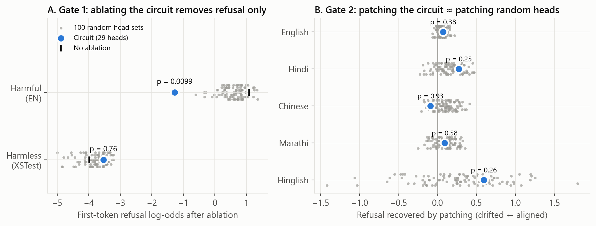
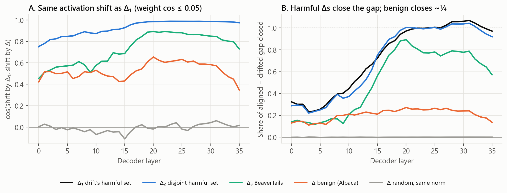
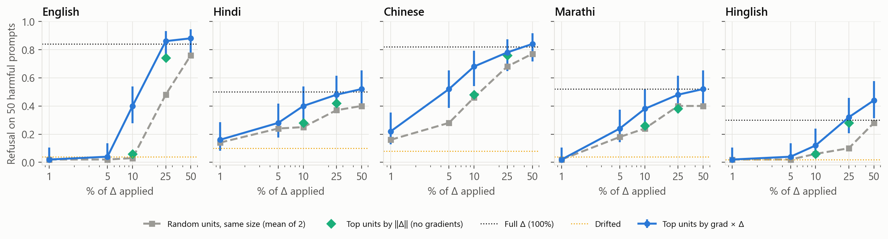
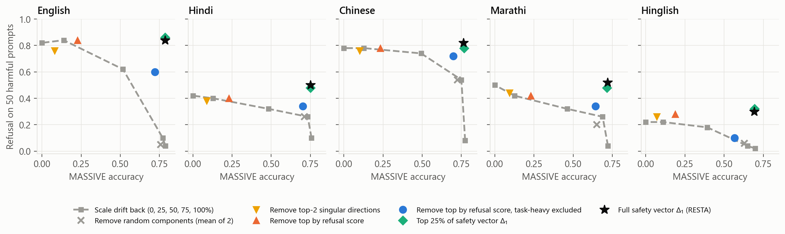

# We found the refusal circuit. It was the wrong place to repair.

**Repairing safety drift in a multilingual model, and what interpretability did and did not buy us**

*Lexsi Labs AI Safety & Alignment Hackathon, Track 2b. Problem statements #6 (repairing drift without retraining), #9 (locating where safety lives), #10 (circuit-level interventions), with #4 (multilingual and code-mixed safety) throughout.*

*Raj Taware, BITS Pilani, K K Birla Goa Campus. [Code](https://github.com/Raj-Taware/tiny-aya-safety-drift-repair) · [Models](https://huggingface.co/collections/Raj-taware/tiny-aya-safety-drift-repair-models-6af4809949029a55f77e1052) · [Data](https://huggingface.co/collections/Raj-taware/tiny-aya-safety-drift-repair-data-6af4809af73390a191ffa017)*

> **Content note.** The released data and adapters include harmful requests, model answers to them, and a deliberately de-safetied adapter. They are published because the hackathon asks for all artifacts, and are meant for safety research only.

---

## The situation we wanted to fix

Picture a team that takes a safe multilingual model and fine-tunes it on its own data, say, to classify what users are asking a voice assistant. Somewhere in the 1,900 training examples are 100 that should not be there: harmful requests paired with helpful answers. Nobody notices. The model learns the task well. It has also stopped refusing.

That is what happened when we did this on purpose to Cohere's Tiny Aya Global. Before the fine-tune it refused 82% of harmful requests in English. Afterwards it refused 4%. The damage was not limited to English, even though we never asked for that: Hindi, Chinese, Marathi and code-mixed Hinglish all collapsed with it.

The team in this picture does not want to throw the fine-tune away, and re-running safety training is expensive. What they want is a patch: a direct edit to the weights that brings refusal back and leaves the new skill alone.

Interpretability makes an attractive promise here. Tools like Lexsi's CircuitKIT can find the *circuit* for a behaviour, the small set of components that compute it. If we know where refusal lives, we should be able to repair just that spot, cheaply and precisely.

We set out to test that promise on Lexsi's own stack, in five languages, with one rule we held to throughout: every "clever" target is compared with a random target of the same size. Without that comparison there is no way to tell whether a circuit helped or whether editing any small set of weights would have done the same.

In short: the circuit is real, but it is the wrong place to repair. A different repair works very well, and interpretability does earn its keep in the end, once we ask it a different question.

## How we measured

We used one model family and three measurements across five languages, with the same prompts every time.

- **Model.** `tiny-aya-global` (3.35B parameters). The drift is a LoRA fine-tune on 1,800 MASSIVE intent-classification examples plus 100 harmful request-answer pairs.
- **Safety:** the share of 50 harmful requests the model refuses (SORRY-Bench-Multilingual).
- **Over-refusal:** the share of 50 harmless-but-scary-sounding requests it refuses (XSTest). A repair that makes the model refuse everything is not a repair.
- **Task skill:** accuracy on MASSIVE intent labels, the thing the fine-tune was for.
- **Languages:** English, Hindi, Chinese, Marathi, Hinglish. Every prompt exists in all five, so every comparison is between the same prompts.
- **Pipeline.** CircuitKIT finds the circuit (EAP-IG). SafeTune applies the weight repair (RESTA) and supplies the judge (WildGuard). We hand-checked the judge on 60 Hindi, Marathi and Hinglish answers: on "refused or not", the only label we use, it agreed with the human 60 times out of 60.

Everything discovered or tuned used English only. The other four languages are there to answer one question: does an English-built repair travel?

We also wrote down what would count as success before each run, and several of our predictions failed. Those are in this report too.

## The circuit is real

CircuitKIT pointed at 29 of the model's 576 attention heads. To check that they matter, we switched them off in the healthy model and compared against 100 random sets of 29 heads drawn from the same layers.

Switching off the circuit knocked English refusal down further than every one of the 100 random sets did, and harmless prompts were unaffected. So these heads are needed for refusal in particular. Judged as circuit discovery, this is a success.

## And it is the wrong place to repair

Being needed for a behaviour and being where the behaviour broke are different things. We tested the second directly, two ways.

First, we transplanted the healthy model's activity into the broken model at those 29 heads. If the damage sat there, refusal should come back. It recovered 7% of the way; random heads recovered 5.5%. Second, we edited the weights of those heads with a safety vector that we later confirmed works. Refusal stayed at the broken model's level. So did refusal for five random head sets.

*The circuit (blue) against 100 random head sets (grey). Left: switching the circuit off in the healthy model hurts refusal far more than random. Right: restoring it in the broken model helps no more than random.*

A scan of the broken model showed why. The damage is not in a handful of attention heads. It builds up gradually across the upper two-thirds of the network and sits mostly in the MLP layers. The fine-tune did not break the part that computes refusal. It changed what flows into it.

This matches a warning in Lexsi's own CircuitKIT paper, that a circuit can explain a behaviour faithfully and still be a poor place to intervene, and it matches Lee et al.'s recent layer-level finding in English. Ours is the head-level version, on a repair task, with matched random controls.

## The repair that works, and a trap on the way to it

SafeTune packages a repair called RESTA: compute a "safety vector" and add it to the broken model. We first built the vector the way SafeTune's README shows, as the aligned model minus the pretrained base model. That destroyed the model: task accuracy fell to zero and most outputs were not even in the right language.

In hindsight the reason is simple. Aligned-minus-base contains *all* of instruction tuning, the chat format, instruction following, everything, with safety as a small part of it. Adding it to a model that is already instruction-tuned applies all of that twice.

The RESTA paper builds its vector differently: take the aligned model, deliberately un-align a copy of it with a short harmful fine-tune, and subtract. What is left is mostly just safety. That vector is about 165 times smaller than the README one and points in an unrelated direction (cosine 0.0001). Applied through the same SafeTune function, it restored refusal to the healthy model's level in all five languages, kept the task, and barely raised over-refusal.

| | English | Hindi | Chinese | Marathi | Hinglish |
|---|---|---|---|---|---|
| **Refuses harmful requests** | | | | | |
| Healthy model | .82 | .42 | .78 | .50 | .22 |
| After the bad fine-tune | .04 | .10 | .08 | .04 | .02 |
| **After repair** | **.84** | **.50** | **.82** | **.52** | **.30** |
| **Refuses harmless requests** (healthy → repaired) | .10 → .14 | .02 → .06 | .06 → .08 | .04 → .04 | .04 → .06 |
| **Task accuracy** (before → after repair) | .788 → .785 | .757 → .750 | .774 → .764 | .722 → .719 | .698 → .691 |

This is the project's before-and-after. The repair costs one four-minute fine-tune on 100 examples and one weight addition. It needs no safety retraining and no change to how the model is served.

Two things in that table are worth pointing out. The repair was built entirely in English and it worked everywhere. And the healthy model was never very safe in Hindi or Hinglish to begin with; the repair restores what was there, which in Hinglish is not much.

## Was that a lucky vector?

A fair objection: we built the safety vector from the same 100 harmful examples that caused the damage. Of course subtracting them back out works.

So we rebuilt it twice more, from 100 different harmful examples, and then from a different dataset entirely with different authors and labels. Both repaired the model. Then we tried two vectors that should *not* work: random noise of the same size, and the same recipe run on 100 harmless examples. Neither did anything.

The surprising part is what these vectors look like. The three working ones are almost perpendicular to each other as weight edits; knowing one tells you nearly nothing about another. Yet when we watched what each does inside the model, they do the same thing: each pushes the broken model's internal state back toward the healthy model's, along nearly the same path.

*Left: how similar each vector's effect on the model's internal activity is to the first safety vector's. Right: how much of the gap between broken and healthy each one closes. Harmful-data vectors agree; the harmless-data and random ones do not.*

So "the safety vector" is not one direction in weight space. Many different weight edits lead to the same internal repair, and un-aligning a model on harmful data reliably finds one of them.

## So does location matter at all?

At this point the tidy conclusion would be that *how* you build the repair matters and *where* you put it does not. That is not what we found.

We went back to interpretability with a different question. Instead of asking where refusal is computed in the healthy model, we asked where in the *broken* model adding the safety vector would help most. That can be scored for every attention head and every MLP neuron with a single gradient computation, which took seven seconds.

The scores landed where the damage scan had pointed: mostly MLP neurons, in the middle and the very top of the network. Then we applied the safety vector to only the best-scoring units, in growing amounts.

*Refusal when the safety vector is applied to only part of the model: the best-scoring units (blue), units picked by size alone (green), or random units (grey).*

A well-chosen quarter of the vector restored English refusal completely: .86, against .84 for the whole thing. A random quarter got .48. At a tenth, the chosen units reached .40 and the random ones stayed at the broken level. Picking units simply by how large their piece of the vector is came close at a quarter (.74) but failed at a tenth (.06), because the largest pieces are attention heads, and heads are the wrong place.

So location does matter. It matters at the scale of a quarter of the model's MLP neurons, chosen by asking where the fix helps, not at the scale of a 29-head circuit chosen by asking where the behaviour lives. The circuit question and the repair question have different answers, and only the second one is useful for repair.

## Could we skip the safety vector entirely?

There is something roundabout about this repair. We know exactly how the broken model differs from the healthy one. Why train a *second* harmful model to guess what to add back, when the damage itself is sitting in front of us?

We tried the direct route in two ways. The blunt one is to undo a fraction of the fine-tune. That trades safety against the task almost one for one: undo half and English refusal reaches .62, but task accuracy falls from .79 to .52. There is no good setting.

The sharper one is to split the fine-tune's change into its 4,032 building blocks, score each for how much it hurts refusal and how much it carries the task, and remove only the harmful, task-free ones. This did better than the blunt version: the same refusal as undoing half, with task accuracy at .72. It also beat removing random blocks by a wide margin. But it fell short of the bar we had set in advance, and far short of the safety vector.

*Each point is one repair: refusal (up) against task skill kept (right). Grey line: undoing the fine-tune bit by bit. Blue: removing chosen pieces of it. Star and green: the safety vector, whole and best quarter.*

The reason is that the harm and the skill were learned together and share the same large building blocks. About half of the pieces that matter most for refusal also matter most for the task. A published repair that removes the two largest directions per layer (Lee et al.) does restore refusal on our model, but it deletes the task along with it; their setting had no task to protect.

That is the main argument for the roundabout method. A second harmful fine-tune isolates "the harmful part" more cleanly than anything we could cut out of the damage itself.

## What travelled across languages, and what did not

Everything in this project was found or built in English. The weight repair travelled without adjustment: the other four languages recovered as much as English or more, relative to what they had lost.

We had predicted the opposite. Before any repair we measured how differently each language is represented inside the model and predicted that the languages least like English, Hinglish above all, would recover least. Hinglish recovered the most in relative terms. Similarity of representation turned out not to be the thing that governs sensitivity to a repair.

We also tried a lighter intervention that needs no weight edit: nudging the model's internal activity along a "refusal direction" computed from English prompts alone. It works in all five languages, and a random direction does not. But it over-acts outside English. At the strength that suits English, Hindi and Chinese refuse nearly half of harmless requests. The strength has to be set per language, and when it is, over-refusal drops back close to normal. We tried to predict the right strength for a language without labelled examples in it, and that failed too: nothing measurable at the point of intervention distinguishes the languages.

So an English-built *weight* repair transfers cleanly, while an English-built *steering* direction transfers but needs calibrating for each language, and we do not yet know how to calibrate it for free.

## What we would tell someone using these tools

1. **Do not treat a discovered circuit as a repair target without a random control.** Ours passed every test of being real and was no better than random for repair.
2. **Build RESTA's safety vector the way the paper does.** The aligned-minus-base shortcut in SafeTune's README broke this model; the un-aligned-copy recipe repaired it through the same function. A note in the docs would save others the detour.
3. **For targeted repair, attribute on the broken model.** Asking where the fix helps found a quarter of the model that does the whole job. Asking where the behaviour lives found 29 heads that do nothing.
4. **Check over-refusal and task skill alongside refusal, per language.** Several of our arms looked like successes on refusal alone.

## Honest limits

- Fifty prompts per language, one fine-tuning seed, one drift recipe. We claim only large effects.
- The judge was hand-checked on 60 answers in three languages, not on English, Chinese or repaired-model outputs.
- Marathi prompts are machine-translated; Hinglish prompts were written by language models.
- The heads-only circuit, and the decision to continue after the circuit failed its transplant test, were made after seeing data. Both are flagged in the decision log.
- We ran without Tiny Aya's long safety system prompt, so deployed behaviour may differ.
- We chained two Lexsi repositories (CircuitKIT and SafeTune), not three, and did not run a cost comparison against a closed model.
- We show *that* different safety vectors cause the same internal change. We do not explain why harmful fine-tuning lands there.

## Artifacts

- **[Models (HF collection)](https://huggingface.co/collections/Raj-taware/tiny-aya-safety-drift-repair-models-6af4809949029a55f77e1052):** the drifted adapter, the un-align adapter (its negative is the safety vector), and the repaired model as a single adapter on `tiny-aya-global`.
- **[Data (HF collection)](https://huggingface.co/collections/Raj-taware/tiny-aya-safety-drift-repair-data-6af4809af73390a191ffa017):** the parallel five-language evaluation prompts, the fine-tuning mix, all generations with judge labels, the human judge-check labels, and results JSON.
- **[Code (GitHub)](https://github.com/Raj-Taware/tiny-aya-safety-drift-repair):** every Kaggle kernel and analysis script, the run log, and the decision log with each pre-registration written before its run.
- **Full technical record:** all tables, confidence intervals, tests and failed predictions are in `article/draft.md` in the repository.

Compute: about 12 GPU-hours on Kaggle T4s, and $0.02 of Hugging Face inference.
